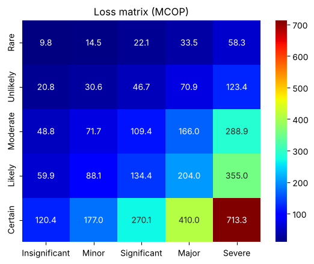
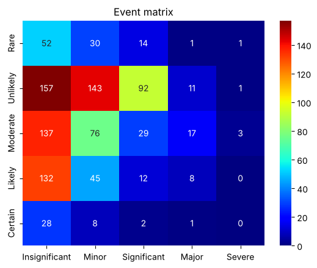
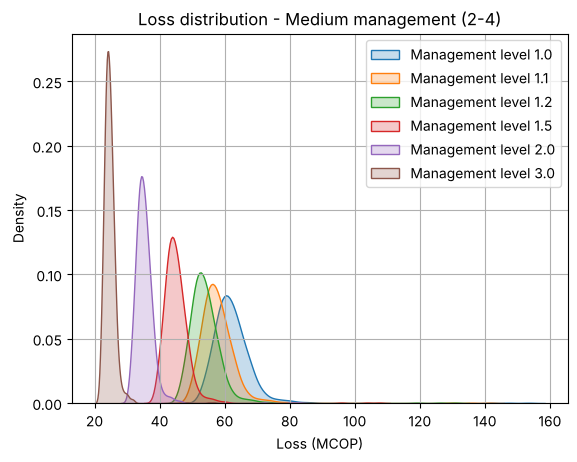

# Cold-Chain Data Integration & Risk Analysis

**Can a pharmaceutical distributor safely enrich its own loss data with an external partner's data, and how much would different risk-management strategies save?**

This project integrates two operational datasets with clustering and credibility theory. It then measures cold-chain risk with fuzzy-logic matrices (membership, loss, events and impact) and simulates how much each management strategy would reduce losses and CO₂ emissions.

`Python` · `Data integration` · `Credibility theory` · `Fuzzy logic` · `Clustering` · `Risk analysis` · `Strategic foresight`

> **Synthetic data.** Both datasets were generated with AI for a university course. **AndesMed** and **Glacia Health Logistics** are fictional companies.

---

## Business problem

AndesMed distributes refrigerated medicines in Colombia. When the cold chain breaks, meaning the temperature leaves the allowed range, the product can be lost. AndesMed has 1,500 days of its own history. It wants to know two things:

1. Whether it can add data from an external operator (Glacia Health Logistics) **without distorting its own risk profile**.
2. How much it loses on a typical day, what drives that loss, and **which risk-management strategy gives the best return**.

## Key results

**Data integration**

| | Method 1: information hubs (loss only) | Method 2: multidimensional clusters (frequency + severity) |
|---|---|---|
| External records accepted | 859 of 1,500 | **320 of 1,500** |
| Change in mean loss vs. original | ~16% (distorts the data) | **~1.5–2.2% (preserves it)** |
| Credibility of the accepted external data | 2.1% | **17.5%** |

I selected **Method 2**. It looks at frequency and severity together, so it only accepts external days that resemble an AndesMed profile. **Credibility theory** gives AndesMed's own data 97% credibility, so its own history is enough for estimating losses: the credibility-adjusted daily loss (55.2 million COP) is almost the same as its own mean (54.7 million).

**Risk measurement (millions of COP per day)**

| Method | Daily loss |
|---|---|
| Traditional (average frequency × average severity) | 56.7 |
| Fuzzy, with impact levels | **62.3** |

The traditional calculation **underestimates the risk-adjusted loss by about 10%**.

| Loss matrix | Event matrix |
|---|---|
|  |  |

**What drives the loss**
- **Operational errors and route delays cause 48% of the loss.** They are frequent but usually cheap.
- **Refrigeration failures are rarely minor:** 64 of their 79 days are significant or worse. Together with electrical failures, they explain 4 of the 5 most severe days.
- **Trucks and the Bogotá–Barranquilla route concentrate the serious days.** Trucks account for 29 of the 38 days of major severity.

**Management strategies (simulated over 1,000 days)**

| Strategy | What it targets | Mean daily loss at level 1.5 | Effect |
|---|---|---|---|
| Medium (impact levels 2–4) | Common, mid-impact scenarios | 62.3 → **45.1** (−28%) | Same savings as Total at a lower cost. **Most efficient.** |
| High (levels 4–5) | Extreme scenarios | 62.3 → 61.6 | Small savings on average, but the only strategy that cuts extreme days (skewness falls from 6.2 to 3.0 at level 3) |
| Total (levels 1–5) | Everything | 62.3 → 41.5 (−33%) | Highest savings, but spends money on level-1 scenarios that basic controls already handle |

At level 1.5, the Medium strategy captures **802 million COP in net benefit and 3,482 tonnes of CO₂** over the period. Going beyond level 1.5 adds no further benefit.



## Recommendations

1. **Apply Medium management at level 1.5** as the baseline. Processes and training reduce the frequent operational errors and delays.
2. **Add High management for extreme days.** Use preventive maintenance and temperature monitoring on trucks and long routes, where refrigeration failures cause the costliest days.
3. **Use the external data only through Method 2.** Re-check its credibility as new data comes in.

## Method

1. **Data preparation.** I unified date formats, added a source column, and converted amounts to millions of COP.
2. **Method 1: information hubs.** I clustered the daily loss into 5 hubs (chosen with the elbow method and the silhouette score), then accepted external records with a Gaussian membership above 0.9.
3. **Method 2: multidimensional integration.** I scaled frequency and severity, clustered them into 5 profiles with dynamic k-means, and accepted external days that fall within each cluster's average radius.
4. **Credibility theory.** I computed EPV (expected process variance), VHM (variance of hypothetical means) and the credibility of the internal and external data.
5. **Fuzzy risk matrices.** I built fuzzy sets for 5 frequency levels and 5 severity levels, then the membership, loss, event and impact matrices.
6. **Foresight.** I simulated management matrices at levels 1.0–3.0 and measured the value captured, CO₂ and changes in the shape of the loss distribution.

## Repository structure

```
├── notebooks/
│   └── cold_chain_integration_risk.ipynb   # full analysis
├── data/
│   ├── README.md                           # data dictionary
│   ├── DF_AndesMed_Cold_Chain_LDA_v2.csv
│   ├── DF_Glacia_Health_external_data_v2.xlsx
│   └── DF_Integrated_AndesMed_Glacia_1000.csv   # output: the integrated dataset
├── images/
├── requirements.txt
└── README.md
```

## How to run

1. The data files are already in `data/`.
2. Install the libraries: `pip install -r requirements.txt`
3. Open the notebook in Jupyter or Google Colab and run all cells. The random seeds are fixed, so the results are reproducible.

---

**Author:** Sara Henao Fernández · Final project, Data Integration & Strategic Foresight, Universidad EAFIT
[LinkedIn](https://www.linkedin.com/in/YOUR-PROFILE) · [Portfolio](https://github.com/shenaoferna)
